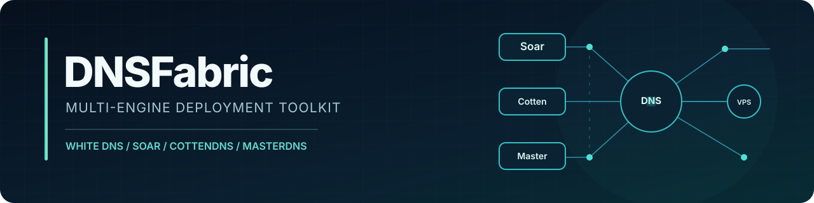

  

  
<strong>Guided, reproducible deployment for self-hosted DNS tunneling.</strong>

  

    
    
    
    
    
  

  

    <a href="#persian">فارسی</a> ·
    <a href="#english">English</a> ·
    <a href="docs/INSTALLATION.fa.md">راهنمای نصب</a> ·
    <a href="docs/MULTI-SERVER.fa.md">چند سرور</a> ·
    <a href="docs/SUBSCRIPTION-PORTAL.fa.md">لینک ساب حرفه‌ای</a> ·
    <a href="SECURITY.md">Security</a>
  

---

  <h2 id="persian">معرفی پروژه</h2>
  
<strong>DNSFabric</strong> ابزاری برای راه‌اندازی مرحله‌ای و قابل‌تکرار پنل رسمی <a href="https://github.com/WhiteDNS/Soar-Server">WhiteDNS Server Management</a> است. نصب‌کننده، مشخصات دامنه و سرور را دریافت می‌کند، پیش‌نیازها را کنترل می‌کند، بسته رسمی را با بررسی SHA-256 دانلود می‌کند و راه‌اندازی HTTPS و صحت سرویس را می‌سنجد.

  
موتورهای <strong>Soar</strong>، <strong>CottenDNS</strong> و <strong>MasterDNS</strong> از طریق پنل بالادستی در دسترس‌اند. DNSFabric خودش پروتکل مستقل، کلاینت اندروید یا سیستم جابه‌جایی خودکار بین موتورها پیاده‌سازی نمی‌کند.

  <h3>قابلیت‌ها</h3>
  <table>
    <thead><tr><th align="right">بخش</th><th align="right">شرح</th></tr></thead>
    <tbody>
      <tr><td align="right">نصب تعاملی</td><td align="right">دریافت IP، دامنه، نام‌سرور، آدرس پنل و حساب مدیر</td></tr>
      <tr><td align="right">کنترل اولیه</td><td align="right">بررسی سیستم‌عامل، فضای دیسک، پورت‌ها و نصب قبلی</td></tr>
      <tr><td align="right">تأیید بسته</td><td align="right">دریافت WhiteDNS نسخه 0.8.2 و بررسی فایل SHA-256</td></tr>
      <tr><td align="right">امنیت دسترسی</td><td align="right">راه‌اندازی HTTPS و مسیر ورود تصادفی با ابزار رسمی</td></tr>
      <tr><td align="right">تأیید نهایی</td><td align="right">کنترل آزمون‌های سمت سرور، وضعیت سرویس و TLS</td></tr>
      <tr><td align="right">آزمون خودکار</td><td align="right">تست‌های نحوی و شبیه‌سازی فرایند نصب در GitHub Actions</td></tr>
    </tbody>
  </table>

  <h3>افزونه لینک اشتراک</h3>
  
برای پنل‌های موجود <strong>WhiteDNS v0.8.2</strong>، افزونه جداگانه <a href="docs/SUBSCRIPTION-PORTAL.fa.md">Subscriber Portal</a> آماده است: لینک هوشمند <code>/s/TOKEN</code> (نمایش داشبورد در مرورگر و خروجی خام برای اپ)، صفحه وضعیت کاربر <code>/u/TOKEN</code>، QR و نمایش مصرف/انقضا. **هر کانفیگ Soar، CottenDNS و MasterDNS به‌صورت جداگانه همراه با دکمه کپی مستقیم** نمایش داده می‌شود؛ صفحه کاربر نام پروژه یا WhiteDNS را نشان نمی‌دهد. لینک قدیمی <code>/sub/TOKEN</code> حفظ می‌شود. این قابلیت از طریق <a href="https://github.com/Net-spoof/dnsfabric/releases/tag/dnsfabric-subportal-v0.8.2.3">بسته سفارشی GitHub</a> نصب می‌شود، نه آپدیت رسمی WhiteDNS.

  
<strong>برای سرور نصب‌شده:</strong> ابتدا بررسی سازگاری را انجام دهید:

~~~bash
curl -fL --show-error --retry 3 \
  -o /root/dnsfabric-update-subportal.sh \
  https://raw.githubusercontent.com/Net-spoof/dnsfabric/main/update-subportal.sh

bash /root/dnsfabric-update-subportal.sh --check
~~~

  
پس از تأیید نسخه، اجرای افزونه:

~~~bash
bash /root/dnsfabric-update-subportal.sh
~~~

  <h3>آموزش‌ها</h3>
  <table>
    <thead><tr><th align="right">مستند</th><th align="right">موضوع</th></tr></thead>
    <tbody>
      <tr><td align="right"><a href="docs/INSTALLATION.fa.md"><strong>نصب کامل</strong></a></td><td align="right">رکوردهای Cloudflare، تمام ورودی‌ها، پیش‌نیازها و آزمون اتصال</td></tr>
      <tr><td align="right"><a href="docs/MULTI-SERVER.fa.md"><strong>چندسروری</strong></a></td><td align="right">طراحی رکوردهای مستقل برای چند VPS</td></tr>
      <tr><td align="right"><a href="docs/SUBSCRIPTION-PORTAL.fa.md"><strong>افزونه لینک ساب</strong></a></td><td align="right">صفحه اختصاصی، لینک کوتاه، QR، حجم و انقضا، دستور آپدیت ایمن</td></tr>
      <tr><td align="right"><a href="docs/TROUBLESHOOTING.fa.md"><strong>رفع خطا</strong></a></td><td align="right">عیب‌یابی DNS، HTTPS، پنل و کلاینت</td></tr>
      <tr><td align="right"><a href="docs/INSTALLATION.en.md">Installation guide</a></td><td align="right">English documentation and setup checklist</td></tr>
      <tr><td align="right"><a href="docs/MULTI-SERVER.en.md">Multi-server guide</a></td><td align="right">English deployment patterns</td></tr>
    </tbody>
  </table>

  <h2>نصب سریع</h2>
  
روی <strong>VPS تازه</strong> و در جلسه SSH تعاملی با دسترسی root اجرا کنید. سیستم‌های پشتیبانی‌شده: Ubuntu 22.04/24.04/26.04 یا Debian 12/13 روی amd64/arm64. سرور باید به GitHub و سرویس صدور گواهی HTTPS دسترسی داشته باشد.

~~~bash
curl -fL --show-error --retry 3 \
  -o /root/dnsfabric-install.sh \
  https://raw.githubusercontent.com/Net-spoof/dnsfabric/main/install.sh

test -s /root/dnsfabric-install.sh \
  && bash -n /root/dnsfabric-install.sh \
  && bash /root/dnsfabric-install.sh
~~~

  
برای بررسی ورودی‌ها بدون نصب:

~~~bash
bash /root/dnsfabric-install.sh --dry-run
~~~

  <h3>نمونه تنظیم دامنه</h3>
  
تمام نمونه‌ها فرضی‌اند و از دامنه رزروشده <code>example.com</code> استفاده می‌کنند. <code>YOUR_PUBLIC_IP</code> را با IP واقعی VPS خود جایگزین کنید.

  <table>
    <thead><tr><th align="right">نوع</th><th align="right">نام رکورد</th><th align="right">مقدار</th><th align="right">وضعیت</th></tr></thead>
    <tbody>
      <tr><td align="right"><code>A</code></td><td align="right"><code>ns-t01</code></td><td align="right"><code>YOUR_PUBLIC_IP</code></td><td align="right">DNS only</td></tr>
      <tr><td align="right"><code>NS</code></td><td align="right"><code>t01</code></td><td align="right"><code>ns-t01.example.com</code></td><td align="right">—</td></tr>
      <tr><td align="right"><code>A</code></td><td align="right"><code>panel01</code></td><td align="right"><code>YOUR_PUBLIC_IP</code></td><td align="right">DNS only</td></tr>
    </tbody>
  </table>
  
<strong>پاسخ‌های نمونه:</strong> دامنه اصلی <code>example.com</code>، دامنه تونل <code>t01.example.com</code>، نام‌سرور <code>ns-t01.example.com</code> و دامنه پنل <code>panel01.example.com</code> است. سقف <strong>۲۴ کاراکتر</strong> فقط مربوط به نام کامل دامنه تونل است. برای جزئیات، <a href="docs/INSTALLATION.fa.md">راهنمای نصب</a> را بخوانید.

  <blockquote><strong>نکته عملیاتی:</strong> این نسخه فقط برای نصب اولیه است. نصب موفق سمت سرور تضمین عبور DNS در شرایط قطع کامل اینترنت نیست؛ مسیر پرس‌وجو و پاسخ Resolver کاربر به نام‌سرور خارجی باید برقرار باشد.</blockquote>

---

<h2 id="english">English</h2>

**DNSFabric** is an independent deployment wrapper for the official **WhiteDNS Server Management** panel. It performs host preflight checks, collects DNS and administrator settings, downloads the pinned WhiteDNS **v0.8.2** bundle with SHA-256 verification, configures HTTPS, and reports credentials after the upstream checks and local TLS verification succeed.

The upstream panel provides selectable profiles for **Soar**, **CottenDNS**, and **MasterDNS**. DNSFabric does not implement a new DNS tunnel engine, modify the Android app, or perform cross-server account synchronization.

| Resource | Description |
|:--|:--|
| [Installation guide](docs/INSTALLATION.en.md) | Prerequisites, Cloudflare A/NS records, prompts and validation |
| [Multiple VPS deployments](docs/MULTI-SERVER.en.md) | Independent per-server records and example hostnames |
| [Subscriber portal add-on](docs/SUBSCRIPTION-PORTAL.en.md) | Smart browser/app links, usage dashboard, QR and version-locked updater |
| [Troubleshooting](docs/TROUBLESHOOTING.fa.md) | DNS, HTTPS and panel diagnostics |
| [Contributing](CONTRIBUTING.md) | Tests and contribution workflow |
| [Changelog](CHANGELOG.md) | Changes and development status |

**Quick start (fresh VPS, root SSH):**

~~~bash
curl -fL --show-error \
  -o dnsfabric-install.sh \
  https://raw.githubusercontent.com/Net-spoof/dnsfabric/main/install.sh
sudo bash dnsfabric-install.sh
~~~

**Important:** DNS records are created manually in this release. The pinned upstream installer is not an automated migration or upgrade path. GitHub Actions cover offline tests, not an end-to-end production deployment.

<strong>Architecture and scope</strong>

~~~text
Android client (one selected engine profile)
                |
         Recursive resolver
                |
       Delegated DNS subdomain
                |
         VPS : UDP/TCP 53
                |
        Official WhiteDNS panel
          /      |       \
       Soar   CottenDNS  MasterDNS
                |
       Supported TCP destinations
~~~

### Upstream and licenses

DNSFabric's original installer code uses the [MIT License](LICENSE). The official [WhiteDNS Server](https://github.com/WhiteDNS/Soar-Server), [WhiteDNS Android](https://github.com/WhiteDNS/WhiteDNS-Android), [Lantern Soar](https://github.com/getlantern/soar), [CottenDNS](https://github.com/WhiteDNS/CottenDns) and [MasterDnsVPN](https://github.com/masterking32/MasterDnsVPN) retain their own licenses and attribution. This repository is not affiliated with upstream maintainers.

DNSFabric · Maintained by <a href="https://github.com/Net-spoof">Net-spoof</a>

